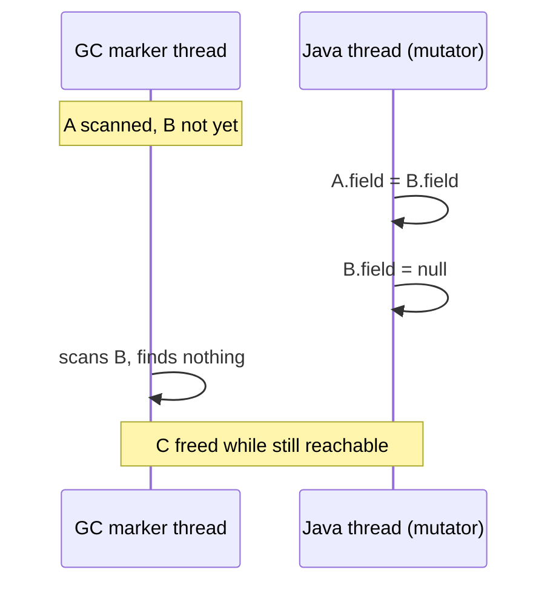

Every time a Java program overwrites a reference field while the garbage collector is marking, the JVM quietly copies the old pointer into a per-thread log, and it does it without a single atomic instruction.

That log is a queue, the first of about a dozen producer-consumer queues inside HotSpot, the C++ program at the heart of OpenJDK, and the next posts in this series take them apart one at a time. This one covers the JVM concepts you need before reading them; you won't need any Java, because everything we read is C++.

<!-- AUTHOR: What sent you into these queues in the first place? A line of code that confused you, a question from the earlier queue posts? One or two true sentences here would replace the preamble that was cut. -->

All source links point at the [`jdk-27-ga`](https://github.com/openjdk/jdk/tree/jdk-27-ga) tag of OpenJDK. Where history matters, later posts will link the older tags where the old code lived.

## HotSpot Is a C++ Program

OpenJDK's virtual machine, HotSpot, lives under [`src/hotspot`](https://github.com/openjdk/jdk/tree/jdk-27-ga/src/hotspot) and is roughly a million lines of C++, with a little assembly per CPU. It contains a bytecode interpreter, two just-in-time compilers, several garbage collectors, a low-overhead event recorder and profiler called Java Flight Recorder (JFR), a logging framework, and a lot of runtime plumbing. When you run `java -jar app.jar`, the `java` launcher loads `libjvm.so` and HotSpot takes it from there.

It is an unusual C++ codebase. It does not use the standard library for anything that matters: not `std::mutex`, not `std::atomic`, not `std::thread`. The [HotSpot style guide](https://github.com/openjdk/jdk/blob/jdk-27-ga/doc/hotspot-style.md#c-standard-library) gives the reasons. HotSpot does not use exceptions or the global allocator, which rules out most containers. It has its own threading, which has to cooperate with the VM in ways we will see shortly. And `<atomic>` is [banned outright](https://github.com/openjdk/jdk/blob/jdk-27-ga/doc/hotspot-style.md#atomic) because HotSpot's atomics "must have semantics which are consistent with those provided by the JDK's compilers for Java", including a "conservative" ordering that may be stronger than sequentially consistent. The C++ runtime and the Java code it compiles share one memory model, so the C++ side cannot leave the details to whichever C++ compiler built it. It also generates much of its hottest code at run time, with an in-process assembler, which means some of the code this series cares most about never exists as a C++ function you could put into Compiler Explorer.

The source layout you will see linked throughout:

| Directory | What lives there |
|---|---|
| `share/runtime/` | Threads, locks, safepoints, the VM thread |
| `share/gc/shared/`, `share/gc/g1/`, ... | Garbage collectors, one directory each |
| `share/compiler/` | The compile queue and the policy that feeds it |
| `share/jfr/`, `share/logging/` | Java Flight Recorder and the logging framework (`-Xlog`) |
| `share/utilities/` | Generic data structures, including some of the queues |
| `cpu/x86/`, `cpu/aarch64/`, ... | Per-architecture assembler and code generators |

## The Thread Cast

A running JVM has far more threads than the program it is running. A Java "hello world" on JDK 27 with default settings starts seventeen OS threads, and only one of them runs `main`. Almost every queue in this series sits between two of them, so it is worth meeting the cast.

<!-- AUTHOR: Show how you counted the seventeen (e.g. `ls /proc/<pid>/task | wc -l` or `jstack`), and paste the thread names. Raw output beats the claim. -->

HotSpot draws one line through all of them, in the class hierarchy comment at the top of [`thread.hpp`](https://github.com/openjdk/jdk/blob/jdk-27-ga/src/hotspot/share/runtime/thread.hpp#L71):

```text
Thread
  JavaThread          # can run Java code, takes part in safepoints
    CompilerThread, ServiceThread, ...
  NonJavaThread       # never runs Java code
    NamedThread
      VMThread
      ConcurrentGCThread
      WorkerThread
    WatcherThread, AsyncLogWriter, ...
```

The ones that matter for queues:

| Thread | Kind | What it does | Shows up in |
|---|---|---|---|
| Application threads | `JavaThread` | Run the user's Java code. GC literature calls them mutators, because from the collector's point of view their job is to mutate the object graph. | every post |
| VMThread | `NonJavaThread` | A single thread that runs "VM operations": anything that needs the whole JVM stopped. | MPSC |
| Compiler threads | `JavaThread` | Pull methods off the compile queue and JIT them. | MPMC |
| GC worker threads | `NonJavaThread` | Do the collector's parallel work; they share it by stealing from each other. | SPMC |
| Concurrent GC threads | `NonJavaThread` | Run collector phases alongside the application, such as concurrent marking. | SPSC, MPMC |
| Service thread | `JavaThread` | A catch-all housekeeper that drains several event queues. | MPSC |
| JFR recorder, async log writer | mixed | Drain diagnostic data that other threads produce. | SPSC, MPSC |

The `JavaThread` / `NonJavaThread` split decides who has to cooperate when the VM needs to stop the world, and that turns out to constrain how HotSpot's locks and queues are built.

## Stopping Threads: Safepoints and Handshakes

Some operations need every application thread frozen at a known point: certain GC phases, deoptimizing compiled code, redefining a class. A C++ program would usually reach for a lock that everyone takes. HotSpot cannot afford that on every operation in the hot path, so it does the reverse: application threads *poll*, cheaply and often, and the VM flips a switch when it needs them to stop.

A point in the code where a thread is allowed to stop is a safepoint. Stopping every Java thread at one is what people mean by a stop-the-world pause. The poll itself is tiny. Here is the one that C2, HotSpot's optimizing just-in-time compiler (more on it below), emitted at the end of a method in the listing we will dissect later:

```nasm
        cmp     0x28(%r15), %rsp    ; compare the stack pointer with this thread's polling word
        ja      .Lslow              ; armed: leave the fast path and stop for the VM
        ret                         ; not armed: return normally
```

`%r15` holds the current `JavaThread*` in compiled code, so `0x28(%r15)` is a field of the thread object, its *polling word*. When the VM wants this thread to stop, it writes a value there that makes the compare fail, and the thread diverts into the runtime and parks. (The same word doubles as a stack watermark used by some collectors, which is why a poll on the return path compares it against `%rsp`; polls elsewhere test a single bit instead. [`MacroAssembler::safepoint_poll`](https://github.com/openjdk/jdk/blob/jdk-27-ga/src/hotspot/cpu/x86/macroAssembler_x86.cpp#L2500) emits both forms.)

Because the polling word is per-thread, the VM can also arm *one* thread instead of all of them. That is a handshake: run a small piece of work against a single thread while it is stopped, and let every other thread carry on. The handshake requests aimed at a thread wait in a queue of their own.

The poll only works if the thread is running code that polls. A thread blocked in a lock, or sitting in native code, is not polling, so HotSpot tracks a state per thread ([`JavaThreadState`](https://github.com/openjdk/jdk/blob/jdk-27-ga/src/hotspot/share/utilities/globalDefinitions.hpp#L1024)): `_thread_in_Java`, `_thread_in_vm`, `_thread_in_native`, `_thread_blocked`. A thread in native code or blocked already counts as stopped for safepoint purposes, as long as it checks in before it touches the heap again. This is why HotSpot's mutexes cannot be a bare `std::mutex`. Underneath there is an ordinary platform lock, but a `JavaThread` that has to wait for it first switches its state to "blocked" ([`Mutex::lock_contended`](https://github.com/openjdk/jdk/blob/jdk-27-ga/src/hotspot/share/runtime/mutex.cpp#L102)), or a stop-the-world pause would wait forever for a thread that is waiting for the lock.

## Finding Live Objects While the Program Keeps Running

A garbage collector frees memory nobody can reach anymore. To find out what is reachable, it marks: starting from the roots (thread stacks, globals), it follows every pointer and flags every object it reaches. Whatever was not flagged is garbage. This is a plain graph traversal, and on a 30 GB heap it takes far too long to do with the program stopped.

So modern collectors mark concurrently, on their own threads, while the mutators keep running and keep rewriting the very pointers the marker is following. You can already see the bug. Here is the classic version, with three objects A, B and C:



B started out pointing to C. The marker finished A before A pointed to C, and reaches B after B stopped pointing to C. C is reachable the whole time and never seen. The collector frees it, and A is left holding a dangling pointer. In C++ terms it is a use-after-free, produced by a reader traversing a structure while a writer rearranges it, the same family of bug as iterator invalidation or the [ABA problem in a lock-free stack]().

Stopping the mutators would fix it, but avoiding exactly that is the reason to mark concurrently, so the JVM fixes it with a barrier instead.

## SATB: Log the Pointer You Are About to Overwrite

A write barrier is a few instructions the JIT compiler inserts around every pointer store in Java code. It is the collector's hook into the mutator: the application never calls the GC, but every pointer store quietly runs GC code.

G1, the JVM's default collector, and Shenandoah use a barrier called SATB, for *snapshot-at-the-beginning*, an idea from Taiichi Yuasa's [1990 paper on real-time collection](https://doi.org/10.1016/0164-1212(90)90084-Y). The name is the rule: every object that was reachable when marking started is treated as live for this cycle. To make that true, the barrier logs the *old* value of any pointer field before a mutator overwrites it. In the race above, the store `B.field = null` first logs C, the marker later drains the log, and C is marked.

While marking is running, every pointer store in every Java thread is now also a *push into a log*, and in an object-oriented language a pointer store is one of the most common things a program does. That is a producer whose fast path has to be nearly free. Take a one-line Java method:

```java
static void store(Node n, Object v) { n.ref = v; }
```

and this is what C2 compiled it to on JDK 27 GA, under G1, captured with `-XX:CompileCommand=print` and the hsdis disassembler. I turned off tiered compilation and inlining so C2 compiles `store` on its own, and pinned the heap at 2 GB so compressed pointers are zero-based, which keeps a shift out of the listing (with a larger heap you will see an extra `shr $0x3` / `shl $0x3` pair). I have kept the SATB part and dropped the method frame, the null check on `n`, and the post-store barrier (which we will come back to at the end of the series):

```nasm
; is marking running? (the common answer is no)
        cmpb    $0x0, 0x48(%r15)    ; this thread's SATB "active" flag
        jne     .Lsatb              ; marking is on: go log the old value
.Lstore:
        mov     %rdx, %r8           ; r8 = the new value (2 GB heap: compressed pointer needs no shift)
        mov     %r8d, (%r11)        ; n.ref = v, the actual store

; out of line, only reached while marking:
.Lsatb:
        mov     (%r11), %r8d        ; load the old value of n.ref
        test    %r8, %r8            ; was it null?
        je      .Lstore             ; nothing to log
        mov     0x40(%r15), %r10    ; r10 = this thread's log index (in bytes)
        test    %r10, %r10          ; index 0 means the buffer is full
        je      .Lfull              ; hand it off to the GC (below)
        sub     $0x8, %r10          ; claim the next slot; the buffer fills downward
        mov     %r10, 0x40(%r15)    ; save the new index
        add     0x38(%r15), %r10    ; r10 = buffer base + index
        mov     %r8, (%r10)         ; write the old value into the log
        jmp     .Lstore             ; then do the store
.Lfull:
        ; spill, then call G1BarrierSetRuntime::write_ref_field_pre_entry(old, thread)
```

There is no `lock` prefix anywhere, and no fence. The log is a plain array owned by one thread, reached through `%r15`: offsets `0x38`, `0x40` and `0x48` are the buffer, index and active fields of the thread's [`SATBMarkQueue`](https://github.com/openjdk/jdk/blob/jdk-27-ga/src/hotspot/share/gc/shared/satbMarkQueue.hpp#L53), declared in that order eight bytes apart. Counting the index *down* to zero is a small trick with a real payoff: "is the buffer full?" becomes a test against zero instead of a compare with a capacity loaded from somewhere. When marking is not running, which is most of the time, the whole barrier is a load, a compare and a branch that almost always goes the same way. G1 flips every thread's active flag on when concurrent marking starts and off when it ends ([`set_active_all_threads`](https://github.com/openjdk/jdk/blob/jdk-27-ga/src/hotspot/share/gc/g1/g1ConcurrentMark.cpp#L941)).

The emitting code is [`generate_pre_barrier_slow_path`](https://github.com/openjdk/jdk/blob/jdk-27-ga/src/hotspot/cpu/x86/gc/g1/g1BarrierSetAssembler_x86.cpp#L173), and it is worth reading for its comments, which annotate each instruction the way I have here. It is also why there is no Compiler Explorer link for this snippet: HotSpot's in-process assembler writes these instructions directly, so there is no C++ to compile. The capture program and the exact JVM flags are in the footer.

<!-- AUTHOR: How did the capture go? Did the first listing come out with the shr/shl pair before you found the heap-size trick? Did -XX:-Inline or compileonly take a few attempts? A sentence of the real process here. -->

Synchronization only appears when the buffer fills, and with the default [`G1SATBBufferSize`](https://github.com/openjdk/jdk/blob/jdk-27-ga/src/hotspot/share/gc/g1/g1_globals.hpp#L157) of 1024 entries, that is at most once every thousand logged pointers. Even then the runtime does not hand the buffer over straight away. The mutator first filters its own buffer, dropping entries the marker no longer needs, and only publishes it if more than 60 percent survive ([`G1SATBBufferEnqueueingThresholdPercent`](https://github.com/openjdk/jdk/blob/jdk-27-ga/src/hotspot/share/gc/g1/g1_globals.hpp#L165), checked in [`handle_zero_index`](https://github.com/openjdk/jdk/blob/jdk-27-ga/src/hotspot/share/gc/shared/satbMarkQueue.cpp#L231)). Otherwise it keeps writing into the space it just freed. When it does publish, it takes a fresh buffer and pushes the full one onto a list shared with the GC's marking threads. Buffers that never fill are not lost either: when marking finishes, G1 [collects every thread's partial buffer](https://github.com/openjdk/jdk/blob/jdk-27-ga/src/hotspot/share/gc/g1/g1ConcurrentMark.cpp#L1758) during a short stop-the-world pause. Either way, the GC only ever reads a buffer after its owner has let go of it, so no buffer has a reader and a writer at the same time. The comment in [`satbMarkQueue.cpp`](https://github.com/openjdk/jdk/blob/jdk-27-ga/src/hotspot/share/gc/shared/satbMarkQueue.cpp#L258) describes the whole lifecycle in one paragraph:

> Per-thread queues obtain buffers from the qset's buffer allocator, fill them, and push them onto the qset's list. The GC concurrently pops buffers from the qset, processes them, and returns them to the buffer allocator for re-use. Both the allocator and the qset use lock-free stacks.

Most of this series is already in that paragraph. Each thread's buffer gets away with no synchronization because only one thread ever writes it, and the handoff pays for synchronization once per buffer rather than once per pointer. The list that buffers are handed to has many producers and several consumers, and it is a *stack* rather than a queue, since marking does not care what order it sees things in. Then there is the memory-reclamation problem every lock-free stack runs into, which the same comment goes on to solve with something called `GlobalCounter` (more on it below). Each of those gets a post of its own.

The collectors differ here. Parallel and Serial, HotSpot's simpler collectors, mark only while the application is stopped, so they need no SATB barrier at all. ZGC, the low-latency collector, does mark concurrently, but with its own design: colored pointers, a load barrier and a store barrier, and a separate per-thread [store-barrier buffer](https://github.com/openjdk/jdk/blob/jdk-27-ga/src/hotspot/share/gc/z/zStoreBarrierBuffer.hpp#L41) instead of G1's SATB queue. Since [JEP 490](https://openjdk.org/jeps/490) removed ZGC's older non-generational mode in JDK 24, that store barrier is the only ZGC there is. Everything in this section describes G1 and Shenandoah.

## Tiered Compilation

HotSpot starts every method in its bytecode interpreter, which is slow but needs no warm-up. As a method runs, the VM counts invocations and loop iterations. When a counter crosses a threshold the method is queued for compilation, first by C1, a fast compiler that produces decent code and keeps profiling, and later, if the method stays hot, by C2, a slow, heavily optimizing compiler. That progression is tiered compilation. (The default thresholds include [`Tier3InvocationThreshold`](https://github.com/openjdk/jdk/blob/jdk-27-ga/src/hotspot/share/compiler/compiler_globals.hpp#L175) at 200 invocations for C1 and [`Tier4InvocationThreshold`](https://github.com/openjdk/jdk/blob/jdk-27-ga/src/hotspot/share/compiler/compiler_globals.hpp#L193) at 5000 for C2, with several other counters in play.)

For this series, what matters is how compile tasks get from one thread to another. Any Java thread can produce a compile task, just by being the one that happens to cross a threshold. Dedicated compiler threads consume them. There are two queues, one per compiler ([`compileBroker.hpp`](https://github.com/openjdk/jdk/blob/jdk-27-ga/src/hotspot/share/compiler/compileBroker.hpp#L200)), and the consumer does not take the oldest task: it scans the whole queue and picks the method that is getting hotter fastest ([`CompilationPolicy::select_task`](https://github.com/openjdk/jdk/blob/jdk-27-ga/src/hotspot/share/compiler/compilationPolicy.cpp#L691)). A consumer that needs to see every element before it picks one is a strong hint about which synchronization strategy won, and the MPMC post is where we find out.

## HotSpot's Concurrency Toolkit

The last piece of vocabulary is HotSpot's own versions of the primitives you already know.

| HotSpot | Closest C++ equivalent |
|---|---|
| [`Mutex`](https://github.com/openjdk/jdk/blob/jdk-27-ga/src/hotspot/share/runtime/mutex.hpp#L168) | `std::mutex` |
| [`Monitor`](https://github.com/openjdk/jdk/blob/jdk-27-ga/src/hotspot/share/runtime/mutex.hpp#L227) | `std::mutex` + `std::condition_variable` |
| [`Atomic<T>`](https://github.com/openjdk/jdk/blob/jdk-27-ga/src/hotspot/share/runtime/atomic.hpp#L34) | `std::atomic<T>` |
| `AtomicAccess::` | `std::atomic_ref` |
| [`GlobalCounter`](https://github.com/openjdk/jdk/blob/jdk-27-ga/src/hotspot/share/utilities/globalCounter.hpp#L34) | RCU, epoch-based reclamation |
| Thread-local GC data | `thread_local` |

Every HotSpot `Mutex` has a rank, and debug builds assert that a thread always acquires locks in rank order, so a lock-order deadlock fails an assertion the first time the order is violated instead of hanging the first time two threads actually race. Every locker also says whether the VM may reach a safepoint while it waits (`_safepoint_check_flag` or `_no_safepoint_check_flag`), which is the cooperation from the safepoint section made explicit. A `Monitor` is a `Mutex` with `wait` and `notify` built in, and most of the blocking queues in this series turn out to be a `Monitor` guarding a linked list.

`GlobalCounter` is the one with no standard equivalent. Readers bracket their access with a cheap critical section, a store to thread-local memory and a fence, and a writer that wants to free memory calls `write_synchronize`, which waits until every reader that might still hold a pointer to it has left. This is how HotSpot's lock-free stacks avoid ABA without [tagged pointers](#making-the-pointer-change). The thread-local GC data is less exotic than it sounds: a fixed block of bytes inside every `Thread` object that the collector owns, reached through `%r15` in compiled code, and the home of the SATB log you just read.

The atomics need a warning, because the history sections in this series will link code from before and after a recent change. `Atomic<T>` is a class template added in JDK 26. Before that, HotSpot spelled every atomic operation as a static function on a plain `volatile` field, through a class that was itself called `Atomic`, and JDK 26 renamed that class to `AtomicAccess`. So `Atomic::cmpxchg(&_top, old, new)` in a JDK 21 or 25 link and `_top.compare_exchange(old, new)` in a JDK 27 link are the same operation.

## Glossary

| Term | Meaning |
|---|---|
| **HotSpot** | OpenJDK's JVM implementation, written in C++ |
| **Mutator** | An application thread, seen from the GC's side: it mutates the object graph |
| **`JavaThread`** | A thread that can run Java code and must take part in safepoints |
| **VMThread** | The single thread that runs operations needing the whole VM stopped |
| **Safepoint** | A point where a thread may stop; stopping all of them is a stop-the-world pause |
| **Handshake** | Stopping one thread to run an operation against it |
| **Marking** | The GC's graph traversal from the roots to find live objects |
| **Concurrent marking** | Marking on GC threads while mutators keep running |
| **Write barrier** | Code the JIT inserts around every pointer store for the GC's benefit |
| **SATB** | Snapshot-at-the-beginning: log a pointer's old value before overwriting it during marking |
| **G1, Shenandoah, ZGC** | HotSpot's main concurrent collectors; G1 is the default |
| **C1, C2** | The fast JIT and the optimizing JIT |
| **Tiered compilation** | Interpreter, then C1, then C2, as a method gets hotter |

## Where the Series Goes Next

The next post is a field guide: the four producer-consumer shapes, SPSC, SPMC, MPSC and MPMC, and a map of where each one appears inside HotSpot. It also sets the one rule the rest of the series relies on, which the SATB log has already hinted at: there may be hundreds of threads producing into it, yet each buffer has exactly one writer, and only the shared list behind the buffers sees many of both. So the field guide classifies each structure by who touches it at the same time, not by how many threads exist.

After that, one post per shape: what the textbook designs are, which one HotSpot picked for each consumer and why, how that choice changed over the years, and benchmarks of the alternatives in C++.

---

Source: OpenJDK [`jdk-27-ga`](https://github.com/openjdk/jdk/tree/jdk-27-ga) (`815ff4dc327f`).

Barrier capture: Temurin 27+35 (the `jdk-27-ga` build), with hsdis built from `src/utils/hsdis` at the same tag against GNU binutils 2.38. The whole capture program:

```java
public class SatbStore {
    static final class Node { Object ref; }

    static void store(Node n, Object v) { n.ref = v; }

    public static void main(String[] args) {
        Node[] nodes = new Node[1024];
        for (int i = 0; i < nodes.length; i++) nodes[i] = new Node();
        Object[] vals = new Object[1024];
        long sink = 0;
        for (int iter = 0; iter < 2_000; iter++) {
            for (int i = 0; i < vals.length; i++) vals[i] = new byte[64];
            for (int i = 0; i < 10_000; i++) store(nodes[i & 1023], vals[(i * 7) & 1023]);
            sink += nodes[iter & 1023].hashCode();
        }
        System.out.println(sink != 0);
    }
}
```

Run with `-XX:+UseG1GC -Xms2g -Xmx2g -XX:+UnlockDiagnosticVMOptions -XX:-TieredCompilation -XX:-Inline -XX:CompileCommand=compileonly,SatbStore::store -XX:CompileCommand=print,SatbStore::store`, with `hsdis-amd64.so` copied into the JDK's `lib/` directory.

Hardware: Intel Xeon Gold 6130 @ 2.10 GHz, Linux 5.15.

**Next:** SPSC, SPMC, MPSC, MPMC: A Field Guide to HotSpot's Queues (coming soon)
