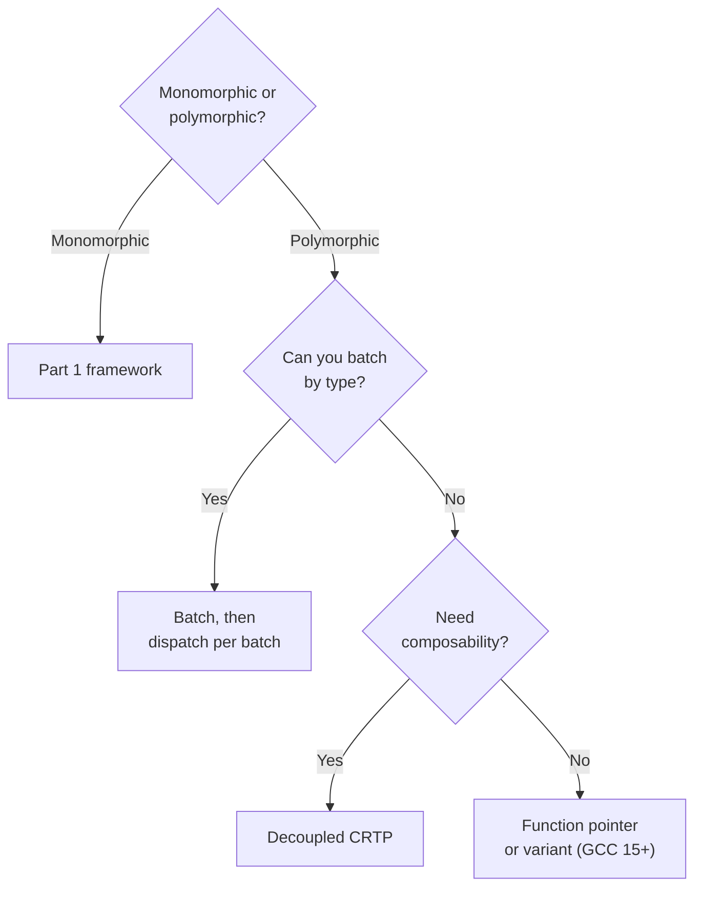

Every dispatch benchmark I've seen, including [the ones I wrote](), tests the same thing: pick one implementation, call it a hundred million times, report the winner.

The branch predictor learns the target on the first few iterations and predicts it perfectly for the remaining 99,999,990. That's the nicest possible scenario for indirect dispatch, and the least realistic one.

Real systems don't work that way. A network stack picks its protocol handler from each packet's headers, so the hot loop sees a mix of concrete types and the dispatch target changes from call to call.

This post measures what happens when you take the four mechanisms from [Part 1]() (virtual dispatch, function pointer, `std::variant + std::visit`, and decoupled CRTP, a compile-time template pattern that [resolves to a cached function pointer]() at runtime) and feed them polymorphic workloads: round-robin, weighted random, and uniform random. The results change the decision framework.

## Setup

Same hardware as the rest of the series: Intel Xeon Gold 6130 @ 2.10 GHz. Two compilers: GCC 11.4.0 and GCC 15.2.0 (the bookends from [Part 4]()). Same flags: `-O2 -march=skylake-avx512 -fcf-protection -falign-functions=64 -falign-loops=64`.

The series uses a GC barrier scenario with three plugin types as its running example, but the dispatch mechanics apply to any strategy pattern. Each benchmark pre-generates a pattern array of 1M plugin indices (Light=0, Medium=1, Heavy=2) before timing begins. The hot loop walks this array, dispatching to whichever plugin the index selects, for 100M total iterations. Here's the virtual dispatch version; the others are structurally identical:

```cpp
BarrierSet* plugins[3] = { &epsilon, &serial, &g1 };
auto pattern = make_pattern(pattern_name);  // 1M entries, pre-generated

for (long i = 0; i < 100'000'000L; ++i)
    plugins[pattern[i % 1'000'000]]->store(
        heap + (i % 64), static_cast<int>(i));
```

No allocation, no branching on the pattern itself. Just the dispatch mechanism under test.

Three workloads, each with a different degree of branch predictor friendliness:

- **Round-robin**: Light, Medium, Heavy, Light, Medium, Heavy, ... A perfectly periodic pattern with period 3. The branch predictor can learn this.
- **Weighted 90/10**: 90% Heavy, 10% Medium, randomly distributed. Close to a realistic workload where one strategy dominates but alternatives appear intermittently.
- **Uniform random**: Equal probability of Light, Medium, or Heavy on each call. Pure chaos for the branch predictor.

For reference, here are the monomorphic baselines from Parts 1 and 4 (Heavy plugin, 100M calls to the same target):

| Mechanism | GCC 11 (ns/call) | GCC 15 (ns/call) |
|-----------|-------------------|-------------------|
| Direct call (baseline) | 1.48 | 1.44 |
| Virtual dispatch | 2.90 | 2.42 |
| Function pointer | 2.43 | 2.42 |
| std::variant + std::visit | 3.71 | 1.47 |
| Decoupled CRTP | 2.42 | 2.41 |

## Round-Robin

| Mechanism | GCC 11 (ns/call) | GCC 15 (ns/call) |
|-----------|-------------------|-------------------|
| Virtual dispatch | 3.05 | 3.05 |
| Function pointer | 2.88 | 2.88 |
| std::variant + std::visit | 4.65 | 2.24 |
| Decoupled CRTP | 2.87 | 2.88 |

Round-robin is the gentlest polymorphic pattern. The target cycles through three values with perfect periodicity, and modern branch predictors handle repeating patterns well. The CPU can learn the sequence and predict each indirect branch correctly most of the time.

CRTP and function pointer are identical: 2.87 vs 2.88 on GCC 11, 2.88 vs 2.88 on GCC 15. This is the design prediction from Part 2 playing out: after lazy resolution, decoupled CRTP collapses to a function pointer array. Under monomorphic dispatch, the two mechanisms looked similar but could have diverged due to code layout or alignment effects. Under polymorphic dispatch, they converge exactly. The function pointer *is* the dispatch mechanism in both cases; CRTP just gave you composability on top.

Variant on GCC 15 is the fastest indirect mechanism at 2.24 ns, faster than function pointer (2.88 ns) and faster than virtual (3.05 ns). The switch-based `std::visit` from GCC 12+ lowers to a jump table on the variant index, and the jump table targets are direct jumps within the same function, giving the optimizer more latitude than an opaque indirect `call` through a function pointer.

Under monomorphic dispatch in Part 4, the compiler hoisted the switch out of the loop entirely: one check, then a tight loop body with no dispatch at all. Under round-robin, the switch executes on every iteration (the variant index changes), but it retains the structural advantage: a jump table `jmp` stays within the function, while a function pointer `call` pushes a return address and jumps to an external function. The 0.64 ns gap (2.88 vs 2.24) is consistent with saving that per-call overhead across 100M iterations.

On GCC 11, variant is worst in class at 4.65 ns. The old function-pointer-table `std::visit` implementation stacks two overheads: the lambda capture round-trip from [Part 3]() and the new cost of cycling through three different dispatch targets. The vtable-style implementation was already slower for one target; now it's dispatching through three.

Virtual dispatch shows a mild increase from its monomorphic baseline (2.90 to 3.05 on GCC 11), but not much. The assembly tells us why. Here's the monomorphic hot loop from Part 1 next to the polymorphic version, both GCC 15:

```nasm
; MONOMORPHIC (Part 1): one plugin, called 100M times
  movq   8(%rsp), %rdi          ; load the same BarrierSet* every time
  movq   (%rdi), %rax           ; vptr (same address every iteration)
  movl   %ebx, %edx             ; value argument
  call   *16(%rax)              ; vtable[2] (same target every iteration)
  incq   %rbx
  cmpq   $100000000, %rbx
  jne    loop                   ; 7 instructions per iteration
```

```nasm
; POLYMORPHIC (Part 5): plugin changes every iteration
  mov    %r15,%rax              ; rax = i
  mul    %r12                   ; 128-bit multiply for i % 1'000'000
  ; ... 4 instructions computing remainder ...
  movslq (%rbp,%rax,4),%rax    ; load pat[i % PATTERN_SIZE]
  mov    (%rbp,%rax,8),%rdi    ; rdi = plugins[pat[...]] (different object each time)
  lea    (%rbx,%rax,4),%rsi    ; rsi = &heap[i % 64]
  mov    (%rdi),%rax           ; vptr (DIFFERENT address each iteration)
  call   *0x10(%rax)           ; vtable[2] (DIFFERENT target each iteration)
  cmp    $0x5f5e100,%r15
  jne    loop                  ; 11+ instructions per iteration
```
[Benchmark source →](https://github.com/Shubhankar-Gambhir/cpp-dispatch-benchmark)

The vtable lookup is identical in both cases: load vptr, indirect call through vtable entry. What changes is everything before it. The monomorphic version loads one known pointer from the stack. The polymorphic version chases two extra indirections: one into the pattern array, one into the plugins array. More importantly, the branch predictor now sees a different `call *` target every three iterations instead of the same one. A period-3 pattern is easy enough to predict, so the cost stays modest.

## Weighted 90/10

| Mechanism | GCC 11 (ns/call) | GCC 15 (ns/call) |
|-----------|-------------------|-------------------|
| Virtual dispatch | 5.60 | 5.58 |
| Function pointer | 4.67 | 4.63 |
| std::variant + std::visit | 7.08 | 4.31 |
| Decoupled CRTP | 4.65 | 4.63 |

This is the workload that most resembles production. 90% of calls hit the heaviest plugin (the most work per dispatch), and 10% hit a lighter alternative. The distribution is random, seeded deterministically, so the branch predictor can't learn a repeating pattern. But it *can* learn the dominant target and take its chances.

The numbers are higher across the board. Virtual dispatch nearly doubled from its round-robin number (3.05 to 5.58 on GCC 15), and function pointer and CRTP jumped from 2.88 to 4.63. A predictor that bets on the dominant type is right 90% of the time; each of the other 10% costs a pipeline flush of roughly 15-20 cycles on Skylake ([Agner Fog's microarchitecture guide](https://www.agner.org/optimize/microarchitecture.pdf), Skylake chapter), or 7-10 ns at 2.1 GHz.

That accounts for less of the jump than it first appears. At one miss in ten, 7-10 ns per miss adds about 0.7-1.0 ns per call, while function pointer went up by 1.75 ns over round-robin. Part of the remainder is the mix itself: round-robin spends a third of its calls in the Heavy plugin, this workload spends 90% there. I didn't collect counters for this workload, so I can't split the rest more precisely than that.

CRTP and function pointer stay locked together: 4.65 vs 4.67 on GCC 11, 4.63 vs 4.63 on GCC 15.

Virtual dispatch pays a consistent premium over function pointer: about 1 ns on both compilers. The vtable indirection (two dependent loads instead of one indirect call) translates to one extra cache access per dispatch, and that cost persists regardless of misprediction rate. Under monomorphic dispatch this gap was smaller (0.47 ns on GCC 11) because perfect prediction hid some of the latency. Under polymorphic dispatch, the mispredictions amplify the structural cost.

Variant on GCC 15 (4.31 ns) beats function pointer (4.63 ns) again, though the gap has narrowed from the round-robin case. The switch-based dispatch still gives the optimizer an edge, but random arrival order makes the jump table harder to predict than the repeating pattern did.

Variant on GCC 11 (7.08 ns) is worst in class by a wide margin. It stacks the old `std::visit` overhead on top of the misprediction penalty. If you're on GCC 11 and your workload is polymorphic, variant is the wrong choice.

## Uniform Random

| Mechanism | GCC 11 (ns/call) | GCC 15 (ns/call) |
|-----------|-------------------|-------------------|
| Virtual dispatch | 17.61 | 17.57 |
| Function pointer | 14.11 | 14.15 |
| std::variant + std::visit | 18.89 | 13.95 |
| Decoupled CRTP | 14.11 | 14.15 |

Every call is a three-way coin flip. There's no pattern to learn and no dominant target to bet on, so no predictor, however much history it tracks, can do better than chance: the indirect call should miss about two times in three.

Here are the hardware counters for the random pattern on GCC 15, alongside monomorphic baselines:

| Mechanism | ns/call | Branch miss rate | IPC | Instructions |
|-----------|---------|-----------------|-----|--------------|
| Virtual (random) | 17.55 | 22.0% | 0.58 | 10.8B |
| FnPtr (random) | 14.15 | 22.0% | 0.66 | 9.8B |
| Variant (random) | 13.95 | 23.5% | 0.66 | 9.6B |
| CRTP (random) | 14.15 | 22.0% | 0.66 | 9.8B |
| Virtual (mono) | 2.42 | 0.00% | 3.18 | 1.6B |
| Variant (mono) | 1.47 | 0.01% | 3.00 | 0.9B |

The branch miss rate is ~22% across all four mechanisms. That looks low for a coin flip until you remember `perf` divides by every branch, not just the indirect call. The store functions are branch-free, so the hot loop retires three branches per iteration: the indirect call, its return, and the loop back-edge. The return and the back-edge predict perfectly. Two misses in three on one branch out of three works out to 2/9, or 22%. IPC collapses from 3.0-3.2 (monomorphic) to 0.6 (random). The CPU spends most of its time waiting for mispredicted branches to resolve rather than executing useful work.

Function pointer went from 2.88 ns (round-robin) to 14.15 ns (random), a 4.9x increase. Virtual went from 3.05 to 17.57, a 5.8x increase. Most of each call is now misprediction recovery.

But the relative order still matters.

CRTP and function pointer are still identical: 14.11 and 14.11 on GCC 11, 14.15 and 14.15 on GCC 15.

Virtual dispatch adds 3.4 ns over function pointer (17.57 vs 14.15 on GCC 15), up from about 1 ns in the weighted case.

Variant on GCC 11 posts the worst number in the series, 18.89 ns, with the old vtable-based `std::visit` adding its own indirection on top of the mispredictions. On GCC 15 it drops to 13.95 ns, slightly ahead of function pointer at 14.15 ns.

When the CPU can't predict the branch, what matters is the depth of the dependency chain between the mispredicted branch and the correct target address.

A function pointer loads one address and jumps. Virtual dispatch chains two dependent loads (vptr, then vtable entry) before it can jump. On GCC 11, variant stacks even more work: build a lambda capture struct, index into a function pointer table, then indirect-call through it. GCC 15's switch collapses that back to a single jump table lookup within the same function.

Misprediction amplifies these differences. When the CPU discards speculative work after a wrong prediction, recovery time scales with how much setup the correct path requires before reaching the target. That's my best explanation for virtual's 3.4 ns premium: the vtable indirection puts one more dependent load on the recovery path.

## The Full Picture

The tables above presented each workload separately to support the per-section analysis. Here they are consolidated. All values in ns/call.

**GCC 11.4.0:**

| Mechanism | Monomorphic | Round-robin | Weighted 90/10 | Random | Degradation |
|-----------|-------------|-------------|----------------|--------|-------------|
| Virtual | 2.90 | 3.05 | 5.60 | 17.61 | 6.1x |
| FnPtr | 2.43 | 2.88 | 4.67 | 14.11 | 5.8x |
| Variant | 3.71 | 4.65 | 7.08 | 18.89 | 5.1x |
| CRTP | 2.42 | 2.87 | 4.65 | 14.11 | 5.8x |

**GCC 15.2.0:**

| Mechanism | Monomorphic | Round-robin | Weighted 90/10 | Random | Degradation |
|-----------|-------------|-------------|----------------|--------|-------------|
| Virtual | 2.42 | 3.05 | 5.58 | 17.57 | 7.3x |
| FnPtr | 2.42 | 2.88 | 4.63 | 14.15 | 5.8x |
| Variant | 1.47 | 2.24 | 4.31 | 13.95 | 9.5x |
| CRTP | 2.41 | 2.88 | 4.63 | 14.15 | 5.9x |

*Degradation = Random / Monomorphic ratio.*

The clearest finding is what happened to variant. The GCC 12+ switch optimization changes how it behaves under polymorphism too. On GCC 15, variant drops from 4.65 to 2.24 ns under round-robin (52% faster) and from 18.89 to 13.95 ns under random. It goes from worst-in-class on GCC 11 to best-in-class on GCC 15 at every workload.

CRTP and function pointer land within 0.02 ns of each other in every measurement, across all three workloads and both compilers. Under polymorphic dispatch, [lazy resolution]() collapses to a function pointer array. If you don't need composable plugin layers, a raw function pointer gives you the same runtime performance with less code.

Virtual dispatch barely benefits from GCC 15. The vtable indirection is the bottleneck, and compiler upgrades can't optimize it away. Virtual went from 2.90 to 2.42 ns in the monomorphic case (alignment and codegen improvements), but under random dispatch the improvement vanishes: 17.61 vs 17.57.

All mechanisms see a 5-7x slowdown from monomorphic to random, except variant on GCC 15 at 9.5x (1.47 to 13.95). Its monomorphic number was flattered: the compiler [hoisted the switch out of the loop entirely](), and under polymorphic dispatch that optimization has nothing to hoist.

### Updated Decision Framework

Part 1's [flowchart]() asked about extensibility and composability. Polymorphic dispatch adds one question at the top:



Reading the chart: if your call site is monomorphic (same target every time), the [Part 1 decision framework]() still applies. If it's polymorphic, the first question is whether you can restructure to batch calls by type. If you can, each batch dispatches monomorphically and you recover most of the performance. If you can't, mechanism choice matters less because branch prediction dominates the cost. Pick decoupled CRTP if you need composable layers; otherwise function pointer or variant (GCC 15+) are roughly equivalent.

If your hot loop always dispatches to the same type, the Part 1-4 framework holds and mechanism choice matters. If your loop mixes types, the gap between fastest and slowest shrinks from 2.5x (monomorphic, GCC 11) to 1.3x (random, GCC 15). The branch predictor dominates, and all four mechanisms degrade roughly together.

### When You Can Restructure

The biggest win for polymorphic dispatch is reducing how often the branch predictor has to guess. If your loop dispatches to different plugin types in an unpredictable order, consider sorting or grouping by type before dispatching:

```cpp
// Before: mixed dispatch, branch predictor thrashes
for (auto& item : items)
    plugins[item.type]->process(item);

// After: batch by type, each inner loop is monomorphic
std::sort(items.begin(), items.end(),
          [](auto& a, auto& b) { return a.type < b.type; });
for (auto& item : items)
    plugins[item.type]->process(item);  // same target for long runs
```

The sort costs O(N log N) once, but the inner loop now hits the same branch target for each batch of consecutive same-type items. For large N with a small number of types, this can recover most of the monomorphic performance. Whether the sort is worth it depends on your N, your type count, and how expensive each `process` call is relative to the sort overhead.

### Limitations

These benchmarks used 3 plugin types. Three is the minimum for meaningful polymorphism, but real systems may have 8, 15, or more. With more types, the branch miss rate climbs higher (the predictor has more targets to track), and the mechanisms may diverge further. The relative ranking is likely to hold (the structural differences between mechanisms don't change with type count), but the absolute numbers will be worse, and the gap between mechanisms may widen as BTB pressure increases.

---

*Benchmarks run on Intel Xeon Gold 6130 @ 2.10 GHz. GCC 11.4.0 and GCC 15.2.0 (conda-forge, statically linked). Flags: `-O2 -march=skylake-avx512 -fcf-protection -falign-functions=64 -falign-loops=64`. 100M iterations per measurement, 1M warmup, best of 5 runs. Pattern array: 1M entries, pre-generated before timing. PRNG seed: 42. Benchmark source: [cpp-dispatch-benchmark](https://github.com/Shubhankar-Gambhir/cpp-dispatch-benchmark).*

**Series start:** [Four Ways to Dispatch a Runtime-Selected Strategy in C++]()

**Previously:** [Your Stdlib Implementation Matters More Than the Dispatch Pattern]()

**Next:** [The 0.48 ns Ghost: How Code Alignment Broke Our Dispatch Benchmarks]()
