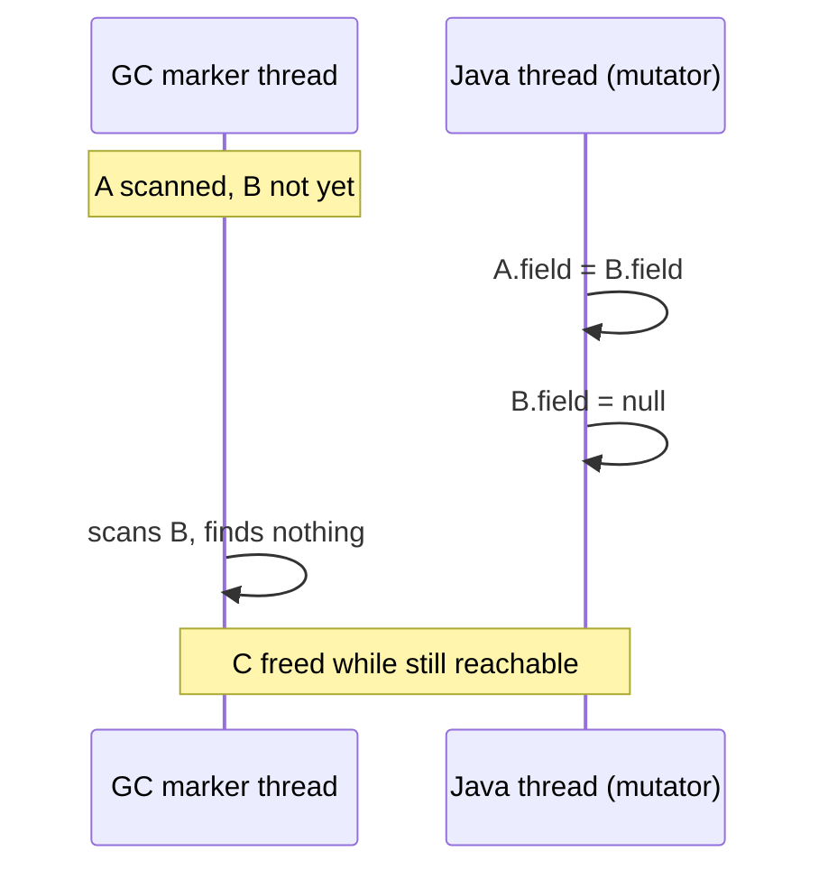

A Java pointer store looks like one `mov`. While G1 is marking, it is also a push into a per-thread log, and the push takes a dozen hand-written instructions, and not one of them is atomic.

That log is the first producer-consumer queue of this series. To see why the collector needs it, you need one piece of garbage-collector theory: how to find live objects while the program keeps running. [The previous post]() covered the rest of the vocabulary used here: HotSpot's threads, its safepoints and its two JIT compilers. Source links point at the [`jdk-27-ga`](https://github.com/openjdk/jdk/tree/jdk-27-ga) tag of OpenJDK.

## Finding Live Objects While the Program Keeps Running

A garbage collector frees memory nobody can reach anymore. To find out what is reachable, it marks: starting from the roots (thread stacks, globals), it follows every pointer and flags every object it reaches. Whatever was not flagged is garbage. This is a plain graph traversal, and on a 30 GB heap it takes far too long to do with the program stopped.

So modern collectors mark concurrently, on their own threads, while the mutators (the application threads) keep running and keep rewriting the very pointers the marker is following. You can already see the bug. Here is the classic version, with three objects A, B and C:



B started out pointing to C. The marker finished A before A pointed to C, and reaches B after B stopped pointing to C. C is reachable the whole time and never seen. The collector frees it, and A is left holding a dangling pointer. In C++ terms it is a use-after-free, produced by a reader traversing a structure while a writer rearranges it, the same family of bug as iterator invalidation or the [ABA problem in a lock-free stack]().

Stopping the mutators would fix it, but avoiding exactly that is the reason to mark concurrently, so the JVM fixes it with a barrier instead.

## SATB: Log the Pointer You Are About to Overwrite

A write barrier is a few instructions the JIT compiler inserts around every pointer store in Java code. It is the collector's hook into the mutator: the application never calls the GC, but every pointer store quietly runs GC code.

G1, the JVM's default collector, and Shenandoah use a barrier called SATB, for *snapshot-at-the-beginning*, an idea from Taiichi Yuasa's [1990 paper on real-time collection](https://doi.org/10.1016/0164-1212(90)90084-Y). The name is the rule: every object that was reachable when marking started is treated as live for this cycle. To make that true, the barrier logs the *old* value of any pointer field before a mutator overwrites it. In the race from the last section, the store `B.field = null` first logs C, the marker later drains the log, and C is marked.

While marking is running, every pointer store in every Java thread is now also a *push into a log*, and in an object-oriented language a pointer store is one of the most common things a program does. That is a producer whose fast path has to be nearly free. Take a one-line Java method:

```java
static void store(Node n, Object v) { n.ref = v; }
```

and this is what [C2](#tiered-compilation) compiled it to on JDK 27 GA, under G1, captured with `-XX:CompileCommand=print` and the hsdis disassembler. I turned off tiered compilation and inlining so C2 compiles `store` on its own, and pinned the heap at 2 GB so compressed pointers are zero-based, which keeps a shift out of the listing (with a larger heap you will see an extra `shr $0x3` / `shl $0x3` pair). I have kept the SATB part and dropped the method frame, the null check on `n`, and the post-store barrier (which comes back in a later post, A Lock-Free Queue With One User):

```nasm
; is marking running? (the common answer is no)
        cmpb    $0x0, 0x48(%r15)    ; this thread's SATB "active" flag
        jne     .Lsatb              ; marking is on: go log the old value
.Lstore:
        mov     %rdx, %r8           ; r8 = the new value (2 GB heap: compressed pointer needs no shift)
        mov     %r8d, (%r11)        ; n.ref = v, the actual store

; out of line, only reached while marking:
.Lsatb:
        mov     (%r11), %r8d        ; load the old value of n.ref
        test    %r8, %r8            ; was it null?
        je      .Lstore             ; nothing to log
        mov     0x40(%r15), %r10    ; r10 = this thread's log index (in bytes)
        test    %r10, %r10          ; index 0 means the buffer is full
        je      .Lfull              ; hand it off to the GC (below)
        sub     $0x8, %r10          ; claim the next slot; the buffer fills downward
        mov     %r10, 0x40(%r15)    ; save the new index
        add     0x38(%r15), %r10    ; r10 = buffer base + index
        mov     %r8, (%r10)         ; write the old value into the log
        jmp     .Lstore             ; then do the store
.Lfull:
        ; spill, then call G1BarrierSetRuntime::write_ref_field_pre_entry(old, thread)
```

There is no `lock` prefix anywhere, and no fence. The log is a plain array owned by one thread, reached through `%r15`, which holds the current thread in compiled code: offsets `0x38`, `0x40` and `0x48` are the buffer, index and active fields of the thread's [`SATBMarkQueue`](https://github.com/openjdk/jdk/blob/jdk-27-ga/src/hotspot/share/gc/shared/satbMarkQueue.hpp#L53), declared in that order eight bytes apart. Counting the index *down* to zero is a small trick with a real payoff: "is the buffer full?" becomes a test against zero instead of a compare with a capacity loaded from somewhere. When marking is not running, which is most of the time, the whole barrier is a load, a compare and a branch that almost always goes the same way. G1 flips every thread's active flag on when concurrent marking starts and off when it ends ([`set_active_all_threads`](https://github.com/openjdk/jdk/blob/jdk-27-ga/src/hotspot/share/gc/g1/g1ConcurrentMark.cpp#L941)).

The emitting code is [`generate_pre_barrier_slow_path`](https://github.com/openjdk/jdk/blob/jdk-27-ga/src/hotspot/cpu/x86/gc/g1/g1BarrierSetAssembler_x86.cpp#L173), and it is worth reading for its comments, which annotate each instruction the way I have here. It is also why there is no Compiler Explorer link for this snippet: HotSpot's in-process assembler writes these instructions directly, so there is no C++ to compile. The capture program and the exact JVM flags are in the footer.

Synchronization only appears when the buffer fills, and with the default [`G1SATBBufferSize`](https://github.com/openjdk/jdk/blob/jdk-27-ga/src/hotspot/share/gc/g1/g1_globals.hpp#L157) of 1024 entries, that is at most once every thousand logged pointers. Even then the runtime does not hand the buffer over straight away. The mutator first filters its own buffer, dropping entries the marker no longer needs, and only publishes it if more than 60 percent survive ([`G1SATBBufferEnqueueingThresholdPercent`](https://github.com/openjdk/jdk/blob/jdk-27-ga/src/hotspot/share/gc/g1/g1_globals.hpp#L165), checked in [`handle_zero_index`](https://github.com/openjdk/jdk/blob/jdk-27-ga/src/hotspot/share/gc/shared/satbMarkQueue.cpp#L231)). Otherwise it keeps writing into the space it just freed. When it does publish, it takes a fresh buffer and pushes the full one onto a list shared with the GC's marking threads. Buffers that never fill are not lost either: when marking finishes, G1 [collects every thread's partial buffer](https://github.com/openjdk/jdk/blob/jdk-27-ga/src/hotspot/share/gc/g1/g1ConcurrentMark.cpp#L1758) during a short stop-the-world pause. Either way, the GC only ever reads a buffer after its owner has let go of it, so no buffer has a reader and a writer at the same time. The comment in [`satbMarkQueue.cpp`](https://github.com/openjdk/jdk/blob/jdk-27-ga/src/hotspot/share/gc/shared/satbMarkQueue.cpp#L258) describes the whole lifecycle in one paragraph:

> Per-thread queues obtain buffers from the qset's buffer allocator, fill them, and push them onto the qset's list. The GC concurrently pops buffers from the qset, processes them, and returns them to the buffer allocator for re-use. Both the allocator and the qset use lock-free stacks.

Most of this series is already in that paragraph. Each thread's buffer gets away with no synchronization because only one thread ever writes it, and the handoff pays for synchronization once per buffer rather than once per pointer. The list that buffers are handed to has many producers and several consumers, and it is a *stack* rather than a queue, since marking does not care what order it sees things in. Then there is the memory-reclamation problem every lock-free stack runs into, which the same comment goes on to solve with something called [`GlobalCounter`](#hotspots-concurrency-toolkit). The last two posts of this series, A Lock-Free Queue With One User and Who Frees the Node?, take those apart.

The collectors differ here. Parallel and Serial, HotSpot's simpler collectors, mark only while the application is stopped, so they need no SATB barrier at all. ZGC, the low-latency collector, does mark concurrently, but with its own design: colored pointers, a load barrier and a store barrier, and a separate per-thread [store-barrier buffer](https://github.com/openjdk/jdk/blob/jdk-27-ga/src/hotspot/share/gc/z/zStoreBarrierBuffer.hpp#L41) instead of G1's SATB queue. Since [JEP 490](https://openjdk.org/jeps/490) removed ZGC's older non-generational mode in JDK 24, that store barrier is the only ZGC there is. Everything in this section describes G1 and Shenandoah.

## Glossary

The table covers both posts. The [thread cast](#the-thread-cast), [safepoints and handshakes](#stopping-threads-safepoints-and-handshakes) and [tiered compilation](#tiered-compilation) have their full explanations in the previous post.

| Term | Meaning |
|---|---|
| **HotSpot** | OpenJDK's JVM implementation, written in C++ |
| **Mutator** | An application thread, seen from the GC's side: it mutates the object graph |
| **`JavaThread`** | A thread that can run Java code and must take part in safepoints |
| **VMThread** | The single thread that runs operations needing the whole VM stopped |
| **Safepoint** | A point where a thread may stop; stopping all of them is a stop-the-world pause |
| **Handshake** | Stopping one thread to run an operation against it |
| **Marking** | The GC's graph traversal from the roots to find live objects |
| **Concurrent marking** | Marking on GC threads while mutators keep running |
| **Write barrier** | Code the JIT inserts around every pointer store for the GC's benefit |
| **SATB** | Snapshot-at-the-beginning: log a pointer's old value before overwriting it during marking |
| **G1, Shenandoah, ZGC** | HotSpot's main concurrent collectors; G1 is the default |
| **C1, C2** | The fast JIT and the optimizing JIT |
| **Tiered compilation** | Interpreter, then C1, then C2, as a method gets hotter |

## Where the Series Goes Next

The rest of the series is a set of histories. Each post follows one HotSpot history through the years it changed, with the review threads, the rejected designs and the bugs left in, and draws out what a C++ developer can take from it.

[Pick Two]() is the asynchronous logger, which between 2020 and 2025 gave four different answers to what happens to a message when its buffer is full. Two Commits, One Day follows the per-thread handshake queue and the VM thread's operation queue, which one engineer reshaped in two consecutive commits on the same day in 2020: the two handshake slots grew into a queue, and the operation queue shrank to a single slot. A Lock-Free Queue With One User follows G1's barrier buffers to the general-purpose lock-free FIFO HotSpot built for them, which had one user in mainline and was deleted once that user stopped needing a queue. Who Frees the Node? closes the series with ZGC's mark stacks and the memory-reclamation problem every lock-free stack runs into.

---

Source: OpenJDK [`jdk-27-ga`](https://github.com/openjdk/jdk/tree/jdk-27-ga) (`815ff4dc327f`).

Barrier capture: Temurin 27+35 (the `jdk-27-ga` build), with hsdis built from `src/utils/hsdis` at the same tag against GNU binutils 2.38. The whole capture program:

```java
public class SatbStore {
    static final class Node { Object ref; }

    static void store(Node n, Object v) { n.ref = v; }

    public static void main(String[] args) {
        Node[] nodes = new Node[1024];
        for (int i = 0; i < nodes.length; i++) nodes[i] = new Node();
        Object[] vals = new Object[1024];
        long sink = 0;
        for (int iter = 0; iter < 2_000; iter++) {
            for (int i = 0; i < vals.length; i++) vals[i] = new byte[64];
            for (int i = 0; i < 10_000; i++) store(nodes[i & 1023], vals[(i * 7) & 1023]);
            sink += nodes[iter & 1023].hashCode();
        }
        System.out.println(sink != 0);
    }
}
```

Run with `-XX:+UseG1GC -Xms2g -Xmx2g -XX:+UnlockDiagnosticVMOptions -XX:-TieredCompilation -XX:-Inline -XX:CompileCommand=compileonly,SatbStore::store -XX:CompileCommand=print,SatbStore::store`, with `hsdis-amd64.so` copied into the JDK's `lib/` directory.

Hardware: Intel Xeon Gold 6130 @ 2.10 GHz, Linux 5.15.

**Previously:** [HotSpot for C++ Programmers: A Million Lines Without std::mutex]()

**Next:** [Pick Two: What Your Queue Does When the Consumer Falls Behind]()
